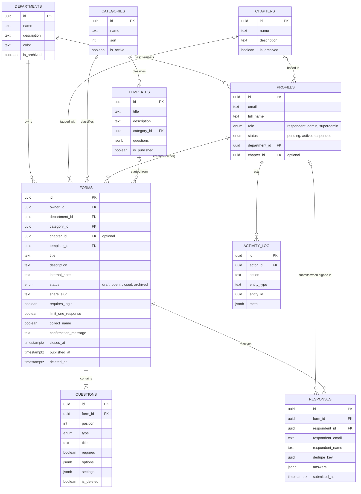
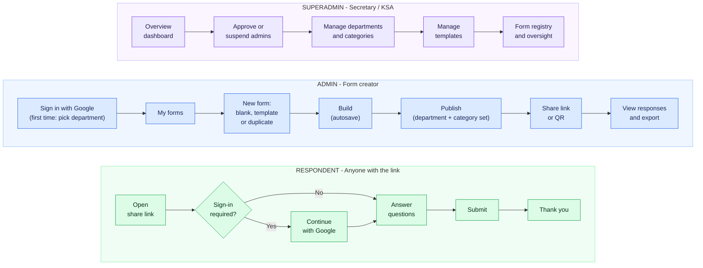
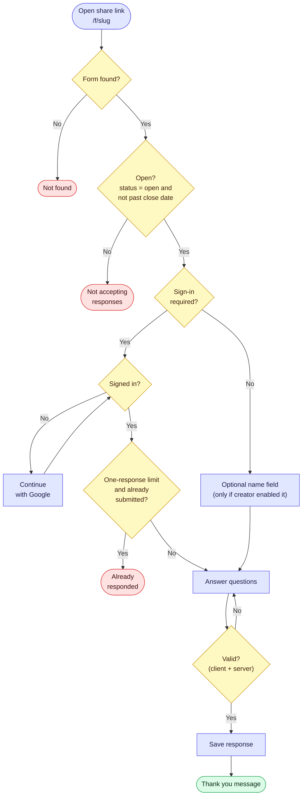

# Build Prompt — PPI Form

You are building **PPI Form**: a Google Forms–style form builder for PPI Malaysia, with a secretary dashboard that tracks which department (and campus chapter) makes which forms.

**Read `PPI_Form_PRD.md` first.** It defines the product, roles, and priorities (P0/P1/P2). This file gives implementation instructions. If the two conflict, the PRD wins for behavior, this file wins for technical choices. Build **P0 only** unless told otherwise.

**Files supplied with this prompt:** `PPI_Form_PRD.md`, `assets/logo.png` (official PPI logo), `seed/departments.json` (12 units), and `diagrams/` (flows and ERD).

If something is ambiguous, pick the simplest option that matches "as easy as Google Forms", and record the choice in `DECISIONS.md`. Do not add features that aren't in the PRD.

---

## 1. Two things that must be excellent

1. **Simplicity.** Creating and answering a form must feel as light as Google Forms. If a step feels like paperwork, remove it or pre-fill it.
2. **Secretary visibility.** Every published form has a department, a category and an owner, and the secretary dashboard can slice by all three plus status, date and response count.

## 2. Non-negotiable rules

1. Respondents never need an account unless the form has `requires_login = true`.
2. Signing in from a form page must **not** create an admin or trigger onboarding.
3. Department and category are **pre-filled** (from the creator's profile and the template) and **required only to publish**. Drafts may lack them.
4. Response counts are **computed from the `responses` table** (view/query). Never let the browser increment a counter.
5. Authorization is enforced **server-side** (RLS and/or server handlers). Hiding a button is not security. There is no client-side "switch role" feature.
6. Public form access goes through server route handlers that return only public-safe fields. Anonymous clients get no direct table access.
7. Share slugs are random (8–10 chars, URL-safe), **not** derived from the title.
8. Autosave in the builder. No "Save" button anxiety; show a "Saving… / Saved" indicator.
9. Editing a live form must not corrupt existing answers: questions have stable IDs; deleting a question that already has answers is a soft delete.
10. Every list and page has loading, empty and error states.

## 3. Recommended stack (swap if needed)

Use this unless the owner tells you otherwise. If your platform differs (for example Base44 or another BaaS), **keep the data model, permissions and behavior** and adapt the implementation.

- **Framework:** Next.js (App Router) + TypeScript
- **UI:** Tailwind CSS + shadcn/ui, lucide-react icons
- **Backend/DB/Auth:** Supabase (Postgres, Google OAuth, Row-Level Security)
- **Charts:** Recharts · **Drag & drop:** dnd-kit · **Validation:** zod
- **Export:** CSV (native) and XLSX (SheetJS or ExcelJS) generated server-side
- **i18n:** next-intl (or equivalent), message files `id` and `en`, default `id`
- **Deploy:** Vercel + Supabase free tiers to start
- **Env:** provide `.env.example` and a README with setup steps. Required: Supabase URL/keys, `SUPERADMIN_EMAILS` (comma-separated; initial value `ahmadfathir0830@gmail.com`, owner will add backups), `NEXT_PUBLIC_APP_URL`.

## 4. Data model (Postgres)

Adapt syntax to your platform. Timestamps are `timestamptz`. Rendered copy of this diagram: `diagrams/erd.png`.



Full schema:

```sql
create type user_role     as enum ('respondent', 'admin', 'superadmin');
create type user_status   as enum ('pending', 'active', 'suspended');
create type form_status   as enum ('draft', 'open', 'closed', 'archived');
create type question_type as enum
  ('short_text','paragraph','single_choice','multiple_choice','dropdown','scale','date');

create table departments (
  id uuid primary key default gen_random_uuid(),
  name text not null unique,
  description text,
  color text not null default '#6B7280',
  is_archived boolean not null default false,
  created_at timestamptz not null default now()
);

create table chapters (               -- campus / branch; separate from departments
  id uuid primary key default gen_random_uuid(),
  name text not null unique,
  description text,
  is_archived boolean not null default false,
  created_at timestamptz not null default now()
);

create table categories (
  id uuid primary key default gen_random_uuid(),
  name text not null unique,
  sort int not null default 0,
  is_active boolean not null default true
);

-- One row per signed-in Google user. Created automatically on first sign-in.
create table profiles (
  id uuid primary key references auth.users(id) on delete cascade,
  email text not null,
  full_name text,
  avatar_url text,
  role user_role not null default 'respondent',
  status user_status not null default 'active',
  department_id uuid references departments(id),
  chapter_id uuid references chapters(id),      -- optional
  created_at timestamptz not null default now(),
  last_seen_at timestamptz
);

create table app_settings (            -- single-row table
  id boolean primary key default true check (id),
  require_admin_approval boolean not null default true
);

create table templates (
  id uuid primary key default gen_random_uuid(),
  title text not null,
  description text,
  category_id uuid references categories(id),
  questions jsonb not null default '[]',   -- same shape as rows in `questions` (without ids)
  is_published boolean not null default true,
  created_by uuid references profiles(id),
  created_at timestamptz not null default now()
);

create table forms (
  id uuid primary key default gen_random_uuid(),
  owner_id uuid not null references profiles(id),
  department_id uuid references departments(id),
  category_id uuid references categories(id),
  chapter_id uuid references chapters(id),      -- optional, never required to publish
  template_id uuid references templates(id),
  title text not null default 'Untitled form',
  description text,
  internal_note text,                       -- P1: visible to owner + superadmin only
  status form_status not null default 'draft',
  share_slug text not null unique,          -- random, see rule 7
  requires_login boolean not null default false,
  limit_one_response boolean not null default true,  -- only meaningful if requires_login
  collect_name boolean not null default false,       -- only meaningful if NOT requires_login
  confirmation_message text,
  theme_color text not null default '#E8080A',
  closes_at timestamptz,                    -- P1
  published_at timestamptz,
  closed_at timestamptz,
  created_at timestamptz not null default now(),
  updated_at timestamptz not null default now(),
  deleted_at timestamptz,                   -- soft delete
  constraint tracking_required_to_publish check
    (status = 'draft' or (department_id is not null and category_id is not null))
);
create index on forms (department_id);
create index on forms (chapter_id);
create index on forms (category_id);
create index on forms (owner_id);
create index on forms (status);

create table questions (
  id uuid primary key default gen_random_uuid(),
  form_id uuid not null references forms(id) on delete cascade,
  position int not null,
  type question_type not null,
  title text not null default '',
  description text,
  required boolean not null default false,
  options jsonb,                            -- string[] for choice types; supports an "other" flag in settings
  settings jsonb not null default '{}',     -- e.g. {"min":1,"max":5,"min_label":"","max_label":"","allow_other":true}
  is_deleted boolean not null default false
);
create index on questions (form_id, position);

create table responses (
  id uuid primary key default gen_random_uuid(),
  form_id uuid not null references forms(id) on delete cascade,
  respondent_id uuid references profiles(id),   -- null for anonymous
  respondent_email text,
  respondent_name text,
  dedupe_key uuid,                              -- = respondent_id when form.limit_one_response, else null
  answers jsonb not null,                       -- { "<question_id>": "text" | ["a","b"] | 4 }
  submitted_at timestamptz not null default now()
);
create unique index one_response_per_person on responses (form_id, dedupe_key) where dedupe_key is not null;
create index on responses (form_id, submitted_at);

create table activity_log (                     -- P1 UI, but write entries from day one
  id uuid primary key default gen_random_uuid(),
  actor_id uuid references profiles(id),
  action text not null,     -- form_created, form_published, form_closed, form_reopened, form_transferred,
                            -- admin_requested, admin_approved, admin_suspended, ...
  entity_type text not null,
  entity_id uuid,
  meta jsonb not null default '{}',
  created_at timestamptz not null default now()
);

create view form_stats with (security_invoker = true) as
select f.id as form_id,
       count(r.id)         as response_count,
       max(r.submitted_at) as last_response_at
from forms f left join responses r on r.form_id = f.id
group by f.id;
```

**Answer storage:** choice answers store the selected **label strings**; multiple choice stores an array; scale stores a number. If an option is renamed later, old answers keep the old label (acceptable).

**Auth bootstrap:** a DB trigger (or first-login handler) creates a `profiles` row with `role = 'respondent'`. If the email is in `SUPERADMIN_EMAILS`, set `role = 'superadmin'`.

**Onboarding:** the `/onboarding` action upgrades a `respondent` to `admin`, sets `department_id`, and sets `status = 'pending'` if `app_settings.require_admin_approval` else `'active'`.

## 5. Authorization

| Resource | Respondent (signed in) | Admin | Superadmin |
|---|---|---|---|
| `departments`, `chapters`, `categories`, published `templates` | read | read | read/write |
| `profiles` | own row | own row + own-department names | all |
| `forms`, `questions` | – | own: create/update/soft-delete. **Publishing requires `status = 'active'`.** Same department: **read-only** (and may duplicate into their own account). | all |
| `responses` | – | read/delete for own forms; read-only for forms in own department | read/delete all |
| `form_stats`, `activity_log` | – | own forms | all |
| `app_settings` | – | – | read/write |

Rules:
- Admins with `status = 'pending'` can create and edit drafts. **Server must reject** any attempt to set a form to `open` while the owner is not `active`.
- `suspended` admins cannot create or publish; their open forms stay open until a superadmin decides.
- Public respondent endpoints (see §7) use the server/service role and validate everything themselves.
- Accounts belong to people; `department_id` on the profile is a tag, not a login. Authentication is **Google only**: no email/password, OTP or reset flows.
- Same-department admins can view and duplicate each other's forms but never edit, publish, close or delete them. Duplicating creates a new draft owned by the duplicating admin.
- Write tests for: pending admin cannot publish, admin cannot read forms or responses from **other departments**, same-department admin can read but not edit, respondent cannot read anything, superadmin can read all.

## 6. Screens and routes

Overall user flow (see also `diagrams/user-flow.png`). State diagrams for form status and admin status are in the PRD (§5.2 and §6.2).



**Public**

| Route | Purpose |
|---|---|
| `/f/[slug]` | Public form (no app chrome). Full behavior in §7. |
| `/login` | Single "Continue with Google" button. Supports `?returnTo=`. |

**App (signed in as admin/superadmin)**

| Route | Purpose |
|---|---|
| `/onboarding` | One screen: name + department + optional chapter → submit. Shown once to a signed-in `respondent` who opens the app. |
| `/dashboard` | Admin: "My forms" grid/list with search and status filter, "New form" and "From template". Superadmin: redirects to `/admin`. |
| `/forms/[id]` | Builder with **three tabs like Google Forms**: **Questions · Responses · Settings**. Header: title, **Department**, **Category** and (optional) **Chapter** selects, Preview, **Publish/Close**. |
| `/templates` | Browse templates → "Use this template". |
| `/admin` | Secretary overview (§8). |
| `/admin/forms` | Form registry (§8). |
| `/admin/forms/[id]` | Read-only detail + superadmin actions. |
| `/admin/departments` | CRUD; archive instead of delete when forms exist. |
| `/admin/chapters` | CRUD; archive instead of delete when forms exist. |
| `/admin/categories` | CRUD (small). |
| `/admin/people` | Admins list; approve/suspend; change department; promote to superadmin. |
| `/admin/templates` | CRUD; "save form as template" also available from the form menu. |
| `/admin/settings` | `Require approval for new admins` toggle. |

Unauthenticated access to app routes redirects to `/login`. A `respondent` opening the app goes to `/onboarding`. A `pending` admin sees a top banner "Waiting for approval — you can build drafts but not publish".

## 7. Public form behavior (`/f/[slug]`)

Flow (see also `diagrams/respondent-flow.png`):



Implement as server handlers: `GET /api/public/forms/[slug]` and `POST /api/public/forms/[slug]/submit`.

**GET** returns only: title, description, department name/color, theme color, questions (non-deleted, ordered), flags (`requires_login`, `collect_name`), and a `state`:

```
not_found  -> no such slug or deleted_at is set
closed     -> status != 'open' OR (closes_at is set and in the past)   [return title + department only]
needs_login-> requires_login and no session
already    -> requires_login and limit_one_response and a response with dedupe_key = user.id exists
open       -> ok to fill
```

**POST submit** (server does all checks again — never trust the client):

1. Load form; reject if not found / not open / past `closes_at`.
2. If `requires_login`: require session; else ignore any identity fields.
3. Validate payload with zod **against the form's questions**: required present, choice values exist in options, scale in range, date valid, text length caps (e.g., 5,000 chars).
4. Honeypot field must be empty; apply rate limit per IP + slug.
5. Set `respondent_id/email/name`:
   - `requires_login` → from the Google profile
   - else if `collect_name` → provided name or null
   - else → all null (anonymous)
6. Set `dedupe_key = respondent_id` only if `requires_login and limit_one_response`. A unique-violation means "already responded".
7. Insert into `responses`. Return `{ ok: true, message: form.confirmation_message }`.

UI notes: one column, one card per question, required marker `*`, inline errors, big tap targets, submit button at the bottom, thank-you screen after success. Footer: short privacy note. Header shows the department badge: **"{Department} · PPI Malaysia"**.

## 8. Secretary pages

**`/admin` overview** — period filter (7d / 30d / this semester / custom). Show:
- KPI cards: total forms, open forms, total responses, forms created in period, departments active in period, pending admin approvals (clickable → people page).
- Charts: forms per department (bar), forms per chapter (bar), forms per category (bar/donut), responses over time (line), forms created over time (line).
- Department table: department, #forms, #open, #responses, last activity — **include departments with zero forms**.
- "Recent forms" (last 10).

**`/admin/forms` registry** — table with columns: title, department (color chip), chapter, creator, category, status, created, last response, response count, link icon. Filters: department, chapter, category, status, creator, date range. Search by title. Sortable. **Export CSV** of the filtered result. Row click → detail page.

**Detail actions (superadmin):** close/reopen, archive, change department/category, transfer owner, soft-delete. Log each to `activity_log`.

Implement aggregates as SQL views/RPC or server queries — do not fetch every response to the browser to count them.

## 9. Builder behavior

- New form → create a draft immediately with a random slug, title "Untitled form", one empty short-text question, and open the editor. `department_id` = creator's department.
- Question card: click to focus; inline title, optional description, type dropdown, required toggle, duplicate, delete, drag handle. Choice types: add option, remove option, optional "Other". Scale: min/max (1–5 default) and optional end labels.
- Floating "Add question" button. Keyboard: Enter in an option adds another option.
- Autosave (debounced ~800 ms) with optimistic UI and a status indicator; warn if offline.
- **Publish** validates: ≥ 1 question, every question has a title, choice questions have ≥ 2 options, department and category selected, owner is `active`. On success show a share dialog: copyable link, "Open", and (P1) QR. Show a clear inline message for each failed check.
- Settings tab toggles per PRD B6. Show *Limit to one response* only when *Require sign-in* is on; show *Collect name* only when it is off.
- Close/reopen is a single toggle in the header.
- Preview opens a respondent-view modal with desktop/mobile width switch (submit disabled).
- Form list actions: open, copy link, duplicate, close/reopen, delete (soft, with confirm).

## 10. Responses tab

- **Summary:** total responses, and per question: bar or pie for choice/dropdown, average + distribution for scale, list of latest answers for text, date list/timeline for date.
- **Table:** one row per response (submitted time, name/email if present, one column per question). Search and sort. Paginate server-side.
- **Export:** CSV and XLSX; column order matches question order; multiple choice joined with `; `.

## 11. Design guidelines

- Google Forms–inspired: light background, centered ~720 px content column, white cards with subtle border/shadow, accent bar on the focused question card.
- **Branding:** the app is called **PPI Form**. Keep app name, logo path (`public/logo.png`, plus favicon) and brand colors in ONE theme/config file. The owner supplied the PPI logo at `assets/logo.png` (copy it to `public/logo.png` and generate a favicon from it). The logo is red, black and white, so use: brand red `#E8080A` as the single accent, a slightly darker red (about `#C80609`) for filled buttons so white text passes AA contrast (verify it), near-black `#111111` for text and headings, white surfaces and light grey borders. Replace the old indigo defaults everywhere, including the chart palette (use red/black/grey plus a few neutral supporting hues for multi-series charts). Forms may override with `theme_color`. Use design tokens/CSS variables; no hardcoded colors scattered through components, so a rebrand is a one-file change.
- Fonts: Inter (body) and Plus Jakarta Sans (headings), loaded once.
- Show the logo in the header (small, left), on the login screen (larger, centered above the Google button), and as the favicon. Do not recolor or redraw the logo; use the supplied file.
- Mobile-first: bottom navigation on small screens for admin pages; sidebar on desktop (admin/superadmin). The public form has **no** navigation chrome.
- Tone: friendly and short. All strings via i18n files (`id` default, `en` alternative).
- Accessibility: labels on all inputs, visible focus, keyboard-operable builder, AA contrast.

## 12. Seed data

- **Departments:** seed exactly the 12 units in `seed/departments.json` (BPH, Biro KSA, Biro Pusdatin, Departemen Kelembagaan, Pendidikan, Keagamaan, Penkastrat, Sosmas, Segaya, Kominfo, Huvoks, Danus). Keep names verbatim. Assign each a distinct color from a small palette. All are managed afterwards from `/admin/departments` (rename, add, archive); do not hard-code the list anywhere in application code.
- **Chapters:** use the list the owner provides; if none, seed placeholders (`Chapter 1…`). Chapter is optional on profiles and forms.
- **Categories:** Event registration, Survey, Feedback / evaluation, Poll / voting, Attendance, Data collection, Other.
- **Templates (published):** modelled on Google Forms' own starter templates, same look and feel. Contact information (name, email, phone, comments), Event registration (name, email/WhatsApp, department/faculty, attendance choice), RSVP (name, attending yes/no/maybe, number of guests, notes), Event feedback (1–5 scales + comments), Attendance (name, session), Simple survey (single choice + paragraph), Poll/voting (single choice), Member data collection (name, university, city, contact). Each with a matching category.
- `app_settings`: `require_admin_approval = true`.
- Provide a dev seed script that also creates sample forms and responses across several departments so the dashboard has data to show.

## 13. Build order (demo at the end of every phase)

1. **Foundation:** project setup, design tokens, i18n, Google sign-in, `profiles` bootstrap, `SUPERADMIN_EMAILS`, onboarding, role-aware layout, pending banner, theme/config file (name, logo, colors).
2. **Data + auth rules:** schema, RLS/authorization, seed data, tests from §5.
3. **Builder:** create/edit/autosave, question types, reorder/duplicate, department/category selectors, templates, duplicate form, preview, publish + share dialog.
4. **Public flow:** `/f/[slug]` with all states, submit handler with validation, dedupe, rate limit, honeypot.
5. **Responses:** summary charts, table, CSV/XLSX export.
6. **Secretary:** overview, registry with filters/export, departments, categories, people (approve/suspend/promote/transfer), templates admin, settings.
7. **Polish:** empty/loading/error states, mobile pass, accessibility pass, README, `DECISIONS.md`.

Only after all P0 items pass §15, start P1 items in the order listed in the PRD.

## 14. Do not

- Do not add email/password auth, OTP, or password reset.
- Do not build a "Member" role, member approval, or a browsable public form directory.
- Do not add a role switcher.
- Do not store response counts on the form row or update them from the browser.
- Do not derive slugs from titles.
- Do not build conditional logic, file upload, payments, quizzes, or Google Sheets sync in P0.
- Do not expose the service-role key to the client.

## 15. Acceptance checklist (P0)

**Creating**
- [ ] A new admin signs in with Google, picks a department, and reaches the dashboard in under 30 seconds.
- [ ] Pending admin can create and edit drafts but publish is rejected server-side with a clear message.
- [ ] "New form" opens an editable form in one click; edits autosave; reload keeps everything.
- [ ] All P0 question types work; reorder, duplicate and delete work on desktop and touch.
- [ ] Department and category are pre-filled; publish is blocked without them; template pre-fills category.
- [ ] Publishing shows a copyable link; closing/reopening is one click.
- [ ] Duplicate form creates an independent copy with a new slug in draft state.

**Answering**
- [ ] Anonymous visitor completes and submits a no-login form on a 360 px-wide screen.
- [ ] Not-found, not-accepting, needs-login and already-responded states each display correctly.
- [ ] Required and invalid answers are rejected by the **server**, not only the UI.
- [ ] Sign-in-required form + one-response limit blocks a second submission from the same account, including under concurrent double-submit.
- [ ] Signing in from a form page does not create an admin or show onboarding.

**Responses**
- [ ] Summary charts and the responses table match the stored data.
- [ ] CSV and XLSX export contain all responses with the right columns.
- [ ] An admin cannot see forms or responses from other departments, and can only view (not edit) forms from their own department (verified by test).
- [ ] An admin can duplicate a same-department form; the copy is a draft owned by them.

**Secretary**
- [ ] Overview shows correct KPIs and charts, and the period filter changes them.
- [ ] Registry lists every form with department, creator, category, status, and response count; filters and CSV export work.
- [ ] Department table includes departments with zero forms.
- [ ] Chapter is optional: a form with no chapter publishes fine; registry and overview can filter/chart by chapter.
- [ ] Changing the logo/colors in the theme file rebrands the whole app (header, favicon, accents) with no other edits.
- [ ] Superadmin can approve/suspend admins, promote a superadmin, transfer a form's owner, and close any form; each action appears in `activity_log`.
- [ ] Archiving a department with forms does not delete or orphan those forms.

**General**
- [ ] Every page has loading, empty and error states.
- [ ] UI strings come from i18n files; `id` and `en` both render.
- [ ] README explains setup, env vars, seeding, and deployment. `DECISIONS.md` lists every assumption you made.
