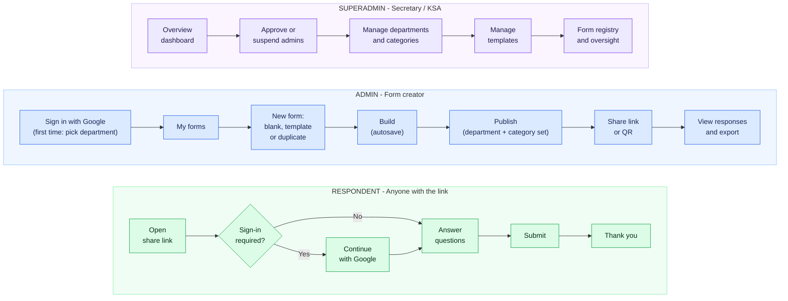
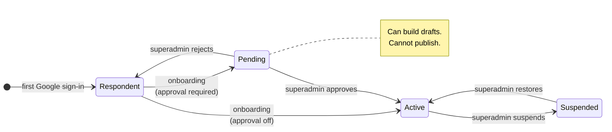
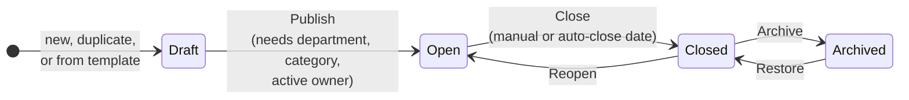
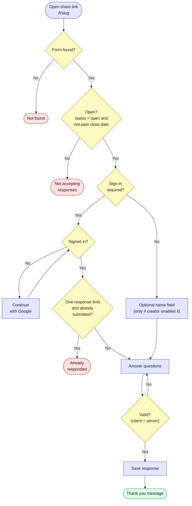
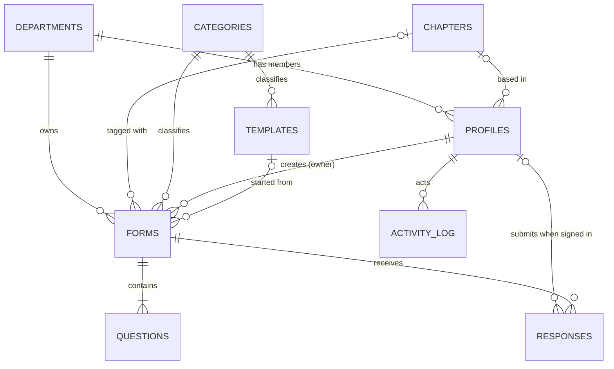

# PRD — PPI Form

**Version:** 1.0 draft · **Owner:** Fathir · **Audience:** product owner, build agent/developers, PPI Malaysia secretariat (KSA/Sekretaris)

> Companion file: `PPI_Form_BUILD_PROMPT.md` (technical instructions for the build agent). This PRD says **what and why**; the build prompt says **how**.

---

## 1. Summary

A Google Forms–style form builder for PPI Malaysia. Any member who is allowed to create forms can build and share one in minutes. Every form is automatically tagged with the **department** that made it and a **category** describing what it's about, so the secretary can see — in one place — which departments are making forms, what those forms are for, and how many responses they get.

**One-line pitch:** *As easy as Google Forms for the people who make and fill forms, and a live registry for the people who keep track.*

## 2. Problem

- Forms are created ad hoc in personal Google accounts. The secretariat has no central view of what exists, who made it, or whether it's still running.
- Departments duplicate work (each rebuilds the same registration/feedback form).
- If the tool is heavier than Google Forms, people will go back to Google Forms and the tracking goal fails.

## 3. Goals and non-goals

### Goals
1. **Effortless creation.** A new admin publishes a first form in under 3 minutes, without reading instructions.
2. **Effortless answering.** Respondents open a link on their phone and submit — no account needed by default.
3. **Automatic tracking.** Department, creator, category, status and response count are captured without extra work from creators.
4. **Secretary visibility.** One dashboard answers: *Which department made forms? What are they about? How many? How many responses? What's still open?*
5. **Reuse.** Provide ready-made templates and one-click duplication.

### Non-goals (v1)
- Being a full Google Forms replacement (no quizzes/grading, file upload, conditional logic, payments).
- Member directory, chat, or general community features.
- Email/password accounts (Google sign-in only).

## 4. Design principles

1. **Copy Google Forms where people already know it** (layout, question cards, Responses tab, share link). Don't be creative in the builder.
2. **Zero-click tracking.** Department is pre-filled from the creator's profile; category is pre-filled from the template. Tracking must never feel like paperwork.
3. **Respondents never see the org's complexity.** No roles, no approval, no app chrome on the public form.
4. **Governance without gatekeeping.** Control who can *publish*, not who can *try*.
5. **Mobile first.** Most respondents and many creators will be on phones.

## 5. Users and roles

| Role | Who | What they can do |
|---|---|---|
| **Superadmin** | Secretary / KSA team (a few people) | Everything an Admin can do, plus: see **all** forms and responses, approve/suspend admins, manage departments, categories and templates, promote other superadmins, close/reassign any form. |
| **Admin** | PPI member in any department who wants to make forms | Create, edit, publish, close and delete **their own** forms; view and export responses to their own forms; use templates. Can also **view, and duplicate, forms from their own department** (read-only, including responses) so work survives handover. |
| **Respondent** | Anyone with the link (members or public) | Open a published form and submit. Signs in with Google **only if** the form requires it. |

**Changes from the earlier draft (and why):**
- **The separate "Member" role and the member approval gate are removed.** The earlier flow made people register and wait for approval before they could even browse forms. That's friction for people who only want to answer a form. Respondents need no account unless a form asks for sign-in.
- **Approval now applies to publishing by admins only**, and admins can start drafting immediately while pending (see §6.1).
- **No "role switcher".** It was UI-only and not a real permission boundary. Permissions are enforced on the server.

### 5.1 User flow by role

> Rendered images of every diagram in this document are in the `diagrams/` folder (PNG and SVG, plus Mermaid sources).

### 5.2 Admin account states

## 6. Functional requirements

Priority: **P0** = MVP (must ship), **P1** = v1.1, **P2** = later.

### 6.1 Sign-in and admin onboarding
| # | Requirement | Pri |
|---|---|---|
| A1 | Sign in with Google (single button). No passwords, OTP or reset flows. | P0 |
| A2 | First sign-in from the app shows a one-screen onboarding: confirm name, **pick department**, optionally **pick campus chapter**, submit. | P0 |
| A3 | Setting `Require approval for new admins` (default **ON**). While pending, the user can create and edit drafts but **cannot publish**; they see a clear "Waiting for approval" banner. When OFF, new admins are active immediately. | P0 |
| A4 | Secretary sees pending admins on their dashboard and approves/rejects in one click; can suspend an admin later. | P0 |
| A5 | First superadmin(s) are bootstrapped from a configured email list; superadmins can promote/demote others (needed for yearly handover). | P0 |
| A6 | When an admin leaves, a superadmin can transfer their forms to another admin. | P0 |
| A7 | Signing in from a form page (because the form requires it) does **not** trigger onboarding or create an admin. | P0 |
| A8 | Accounts belong to **people**, not departments. A department is a tag on the person and on their forms; several admins can share one department. No shared department logins. | P0 |
| A9 | Admins in the same department can **view and duplicate** each other's forms (and see their responses) but cannot edit, publish or close them. Only the owner or a superadmin can; ownership is changed by a superadmin (A6). | P0 |

### 6.2 Form builder (Admin)
| # | Requirement | Pri |
|---|---|---|
| B1 | "New form" → blank form opens instantly with title, description and one starter question. | P0 |
| B2 | Google Forms–style editing: click a question card to edit; add, delete, **duplicate**, **drag to reorder**; required toggle. **Autosave** with a visible "Saved" indicator. | P0 |
| B3 | Question types: short text, paragraph, multiple choice (single), checkboxes (multiple), dropdown, linear scale (e.g., 1–5), date. Choice types support "Add option" and an optional "Other". | P0 |
| B4 | Start from a **template** or blank. Applying a template copies its questions and pre-fills category. | P0 |
| B5 | **Duplicate form** ("Copy of …") from the form list. | P0 |
| B6 | Settings tab: *Accepting responses* toggle, *Require Google sign-in*, *Limit to one response per person* (only when sign-in is on), *Collect name* (only when sign-in is off), confirmation message. | P0 |
| B7 | **Department** (pre-filled from profile, changeable) and **Category** (pre-filled from template) are required to publish. Shown as two dropdowns beside the title — not buried in settings. An optional **Chapter** dropdown (pre-filled from the creator's profile, can be left empty) sits next to them when chapters are defined. | P0 |
| B8 | **Preview** as a respondent (desktop and mobile width). | P0 |
| B9 | **Publish** → dialog with copyable link. Closing/reopening is one toggle. | P0 |
| B10 | Sections / page breaks. | P1 |
| B11 | QR code for the link (useful for event posters). | P1 |
| B12 | Auto-close date/time. | P1 |
| B13 | Internal note ("What is this form for?") visible to the owner and secretary only. | P1 |
| B14 | Theme color and header image. | P1 |
| B15 | Conditional logic, file upload, response limit, collaborators/co-owners. | P2 |

**Form status lifecycle**

### 6.3 Respondent experience
| # | Requirement | Pri |
|---|---|---|
| R1 | Public link `/f/{slug}`, no app navigation, loads fast on mobile data. | P0 |
| R2 | Shows title, description, and a small "**{Department} · PPI Malaysia**" badge so people trust who is asking. | P0 |
| R3 | Inline validation for required fields; keeps answers on error. | P0 |
| R4 | States: **Not found**, **Not accepting responses** (shows form title and department), **Sign in required**, **Already responded**, **Thank you** (custom message if set). | P0 |
| R5 | Sign-in-required forms record the respondent's Google email/name; one-response limit enforced per account. | P0 |
| R6 | No-login forms are anonymous by default; optional name field if the creator enabled it. | P0 |
| R7 | Basic spam protection (rate limiting + honeypot). CAPTCHA only if abuse appears. | P0 |
| R8 | "Submit another response" link on the thank-you page (when not limited). | P1 |
| R9 | "Report this form" link. | P2 |

**Respondent flow**

### 6.4 Responses (Admin, and Superadmin for any form)
| # | Requirement | Pri |
|---|---|---|
| S1 | **Summary** tab: response count and a chart per question (bar/pie for choices, average for scale, list for text). | P0 |
| S2 | **Responses** table: one row per submission with timestamp, name/email (if collected) and answers; search and sort. | P0 |
| S3 | **Export** to CSV and XLSX. | P0 |
| S4 | Delete an individual response (owner/superadmin). | P1 |
| S5 | Email notification to owner on new responses (daily digest option). | P2 |
| S6 | Sync/export to Google Sheets. | P2 |

### 6.5 Secretary oversight (Superadmin) — the reason this product exists
| # | Requirement | Pri |
|---|---|---|
| O1 | **Overview dashboard** with a period filter (7 days / 30 days / this semester / custom). KPI cards: total forms, open forms, total responses, forms created in period, departments active in period, pending admin approvals. | P0 |
| O2 | Charts: **forms per department**, **forms per chapter**, **forms per category**, **responses over time**, **forms created over time**. | P0 |
| O3 | **Form registry**: table of every form — title, department, chapter, creator, category, status, created date, last response, response count. Filter by department, chapter, category, status, creator, date; search by title; sort; **export CSV**. | P0 |
| O4 | **Department table**: department, #forms, #open, #responses, last activity. Departments with **no forms** are visible (so the secretary can spot inactivity). | P0 |
| O5 | Click a form → read-only detail: questions, settings, stats and responses. | P0 |
| O6 | Actions on any form: close/reopen, archive, change department/category, transfer owner, delete (soft). | P0 |
| O7 | **People**: list admins with department, #forms, status; approve, suspend, change department, promote to superadmin. | P0 |
| O8 | Manage **departments** (name, color, archive — never hard-delete one that has forms), **chapters** (campus/branch list, same archive rule) and **categories**. | P0 |
| O9 | Manage **templates**: create, edit, publish/unpublish. "Save this form as a template" from any form. Template usage counts visible. | P0 |
| O10 | **Activity feed**: form created / published / closed, admin approved, ownership transferred. | P1 |
| O11 | Weekly summary email to the secretary. | P2 |

**Suggested categories (editable):** Event registration, Survey, Feedback / evaluation, Poll / voting, Attendance, Data collection, Other.

### 6.7 Initial departments (seed data)

The organisation has 12 units. In the app they are all treated as "departments", so a unit's forms are tracked under its name:

BPH · Biro KSA · Biro Pusdatin · Departemen Kelembagaan · Departemen Pendidikan · Departemen Keagamaan · Departemen Penkastrat · Departemen Sosmas · Departemen Segaya · Departemen Kominfo · Departemen Huvoks · Departemen Danus

Machine-readable copy: `seed/departments.json`. The secretary can rename, add or archive units later from the admin pages, so this list is a starting point, not a hard-coded set. Biro KSA is the secretariat, which is where superadmins sit; it is still a normal department tag for forms made by that unit.

### 6.6 Templates
- Seed at launch, modelled on the starter templates people already know from Google Forms: Contact information, Event registration, RSVP, Event feedback, Attendance, Simple survey, Poll/voting, Member data collection.
- Anyone creating a form can pick a template; the form stores `template_id` so usage is trackable.
- Templates are managed only by superadmins in v1.

## 7. Conceptual data model

Key points:
- **Chapter is a separate, optional field** from department (departments = what part of PPI; chapters = which campus/branch). It sits on both the profile and the form, so the secretary can report by either or both.
- **Form carries `department_id`, `category_id`, `owner_id`** — this is what makes secretary tracking possible.
- **Response count is derived from the responses table**, never a counter the browser updates.
- Questions are their own records with stable IDs so editing a live form doesn't corrupt old answers.
- The full ERD with every field is in the build prompt (and `diagrams/erd.png`).

## 8. Permissions summary

| Action | Respondent | Admin | Superadmin |
|---|---|---|---|
| Fill a published form | ✅ | ✅ | ✅ |
| Create/edit/publish own forms | – | ✅ (publish needs approval if enabled) | ✅ |
| See responses of own forms | – | ✅ | ✅ |
| View + duplicate forms in own department (read-only) | – | ✅ | ✅ |
| See all forms + responses | – | – | ✅ |
| Edit/close/reassign others' forms | – | – | ✅ |
| Manage departments, categories, templates, people | – | – | ✅ |

## 9. Non-functional requirements

- **Performance:** public form loads in < 2 s on 4G; builder interactions feel instant (optimistic UI + autosave).
- **Responsive:** fully usable from 360 px width. Respondent page is the top priority.
- **Security:** authorization enforced on the server (not in UI); unguessable random share slugs; input validation on submit; rate limiting on public endpoints; secrets never in client code.
- **Privacy:** collect only what the form asks; creators can delete responses; anonymous forms store no identity; show a short privacy note in the form footer. (Confirm PPI Malaysia's data-handling policy.)
- **Branding:** the app is named **PPI Form**. App name, logo and colors live in one config/theme file. The palette comes from the official PPI logo (`assets/logo.png`: red, black, white, matching the Indonesian flag colors): near-black text, white surfaces, red as the single accent. Logo appears in the header, login screen and favicon. A rebrand is a one-file change.
- **Accessibility:** keyboard navigable, labeled inputs, sufficient contrast (WCAG AA basics).
- **Language:** UI ready for Bahasa Indonesia and English (default Indonesian — to confirm).
- **Reliability:** daily database backups; soft-delete for forms so the secretary can restore mistakes.
- **Scale assumption:** hundreds of forms and up to tens of thousands of responses per form at most. Don't over-engineer.

## 10. Success metrics

| Metric | Target |
|---|---|
| Time for a new admin to publish first form | < 3 minutes |
| Published forms with department + category set | 100% (enforced) |
| Secretary can answer "how many forms did department X make this semester?" | < 30 seconds |
| Share of organisational forms created in the platform after 2 months | > 70% |
| Respondent completion rate (opened → submitted) | > 85% |
| Active admins per month | Track; set target after first month |

## 11. Release plan

- **MVP (P0):** Google sign-in, onboarding + approval, builder with core question types, templates + duplicate, publish/share, public form flow, responses summary/table/export, secretary overview + registry + departments/people/templates management.
- **v1.1 (P1):** sections, QR code, auto-close, internal note, activity feed, theme color/header, delete response, submit-another.
- **Later (P2):** Google Sheets sync, email notifications and weekly digest, conditional logic, file upload, co-owners, "report this form", anonymous-but-one-per-person option, opt-in public form directory.

## 12. Risks and mitigations

| Risk | Mitigation |
|---|---|
| Builder feels heavier than Google Forms → people don't adopt | Follow Google Forms patterns closely; autosave; blank form in one click; test with 3 real admins before launch. |
| Creators skip department/category | Pre-filled and required only at publish, so it costs zero effort. |
| Someone abuses the platform under PPI's name | Approval before publish; department badge on forms; secretary can close any form instantly. |
| Yearly turnover breaks ownership | Multiple superadmins, promote/demote, transfer forms. |
| Spam submissions on public forms | Rate limit, honeypot, optional sign-in requirement. |
| Data loss from editing questions on live forms | Stable question IDs; soft-delete questions that already have answers. |

## 13. Open questions (defaults are used if unanswered)

1. ~~**Department list**~~ — **Provided** (12 units, see §6.7). **Chapter list** (campus branches) is still needed; placeholders will be seeded until then.
2. **Admin approval** — OK with "draft freely, publish after approval" as the default?
3. **Response privacy** — may superadmins read individual response content (default **yes**, per "global view"), or only counts and form content?
4. **Language** — Bahasa Indonesia default with English toggle?
5. ~~**Sign-in**~~ — **Decided:** Google only. Revisit only if members without Google accounts turn out to be a real problem (then add email magic link, not passwords).
6. **Hosting/budget** — any constraints? (Default: managed free tiers to start.)

## 14. Notes on the earlier diagrams

The user-flow and respondent-flow diagrams are kept in spirit. Changes:
- **Role flow:** "Member → Register → Pending Approval → Available Forms" removed; "Available Forms" (a browsable directory) is deferred to P2 as an opt-in feature.
- **ERD:** the earlier version had duplicated `USER`/`RESPONSE` boxes, put form-level fields (`is_active`, `share_slug`, `response_count`) on `FORM_TEMPLATE`, and had no `department_id`/`owner_id` on `FORM` — the exact fields tracking depends on. The model in the build prompt fixes this.
- **Respondent flow:** kept as is; the "Already submitted?" check applies only when sign-in + one-response limit are on.
